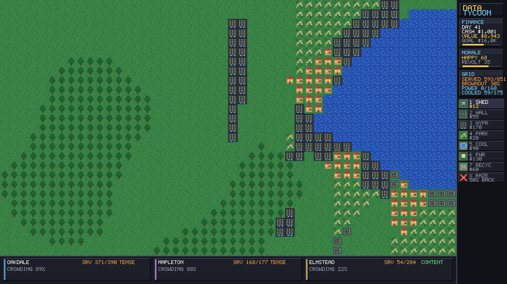

# DATA TYCOON

An 8-bit, turn-based tycoon game (C# / MonoGame). You run a compute company on a procedurally
generated map. Towns emit compute demand that grows every day; only structures inside a town's
catchment serve it. Cheap server sheds get you started, dense data halls and hyperscale campuses
serve more demand per tile of neighborhood anger — but they run hot, so the cool riverfront is
prime real estate. Cooling towers extend that cooling inland, power plants feed the biggest
buildings, and e-waste recyclers earn passive cash. Parks and standing forest keep the neighbors
calm. Reach the company value goal before the towns revolt or the money runs out.

## Run it (Windows)

**Just double-click `Play.bat`.** It builds and launches the game.
(One-time requirement: the free [.NET 8 SDK](https://dotnet.microsoft.com/download/dotnet/8.0).
`Play.bat` will point you there if it's missing.)

Prefer the command line? `dotnet run` — works on Windows and Linux, no content pipeline,
no extra setup.

### Want a portable copy with no .NET install?

- **Windows:** double-click **`MakeStandalone.bat`** → `Standalone\DataCenterTycoon.exe`.
- **Linux:** run **`./MakeStandalone.sh`** → `Standalone-linux/DataCenterTycoon`.

Both produce a self-contained executable that runs with nothing else installed.

## How to play

| Input | Action |
|---|---|
| 1–7 | Select Server Shed / Data Hall / Hyperscale / Park / Cooling Tower / Power Plant / Recycler |
| X or 8 | Select bulldozer (50% refund) |
| Left-drag | Build the selected structure (or bulldoze an area) |
| Right-click | Bulldoze a single tile |
| Space | End the day |
| Z | Undo your last build or raze |
| H | How-to-play overlay |
| M | Mute |
| R / N | Retry this region / new region |
| Esc | Back to menu (or close the help overlay) |

The window is resizable — the game renders at a fixed 1920×1080 and letterboxes to fit.

Build over a cheaper structure to upgrade it in place (you're credited half of what the old
one cost). Blue-tinged riverfront tiles cool upkeep to 55%. Forest tiles cost 2.5x to build
on and clearing them removes their calming effect on the nearest town.

### The structures

| | Cost | Upkeep (cooled) | Serves | Anger load | Power |
|---|---|---|---|---|---|
| Server Shed | $12 | 1.0 (0.6) | 1 | 1.0 | — |
| Data Hall | $55 | 4.0 (2.2) | 3 | 1.9 | draws 0 |
| Hyperscale | $170 | 12.0 (6.6) | 7 | 3.4 | draws 2 |
| Park | $20 | 0.4 (0.2) | — | raises its town's comfort by 3 | — |
| Cooling Tower | $90 | 3.0 (1.7) | — | +1 comfort | draws 1 |
| Power Plant | $130 | 2.0 (1.1) | — | +2.2 anger | supplies 22 |
| E-Waste Recycler | $60 | 1.2 (0.7) | — | +0.6 anger | draws 1 |

Cooling towers cool a 3×3 area to 55% upkeep, so you can run dense buildings inland. Power is
**opt-in**: sheds and halls need none, and the shortfall penalty only applies once you've built a
plant — ignore power entirely and you play the original game. Recyclers earn $6/day passively.

Every strategy tops out somewhere: sheds alone can't outgrow the anger they cause, and towers
without parks run out of tolerant neighbors. Demand grows 5.5% a day forever — you can't serve
it all. Serve what you can, keep the towns just short of furious, and bank the goal.

## For tinkerers

- `dotnet run -- --sim [seeds]` — headless balance harness. Prints the **vanilla four-structure
  ladder** (the regression baseline) and the **extended power/cooling/recycler policies** on real
  generated maps, with win/revolt/bankrupt outcomes per policy.
- `dotnet run -- --sim --selftest` — economy, save/load round-trip, and `v3`→`v4` upgrade tests.
- `dotnet run -- --sim --trace` — day-by-day trace of the skilled policy.
- `dotnet run -- --shot out.png --seed 1000 --days 40` — boots the game, lets a skilled AI
  play N days, saves a screenshot, exits (works headless under xvfb).

CI (`.github/workflows/build.yml`) builds with warnings-as-errors and runs the self-test, the
balance ladder, and a headless render smoke test on every push.

See `PROJECT_NOTES.md` for the full design, the economy model, and how to re-tune the balance.
